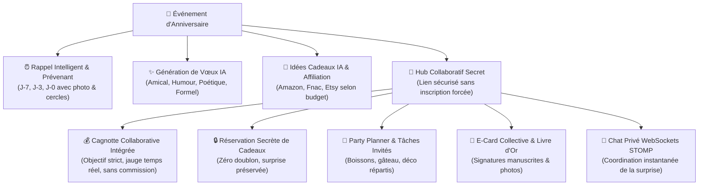

# 📚 Time2Wish Official Wiki · Documentation & Insights

**Le compagnon intelligent et émotionnel dédié à la célébration de ceux qui comptent.**  
*The thoughtful, AI-powered celebration companion for the people you care about.*

---

[🇫🇷 Version Française](#-documentation-en-français) • [🇬🇧 English Version](#-english-documentation)

---

## 🧭 Navigation & Sommaire

### 🇫🇷 Documentation en Français

| Document | Description | Lien |
| :--- | :--- | :--- |
| **01. Storytelling & Vision** | La genèse émotionnelle de Time2Wish, les 5 douleurs universelles, les parcours utilisateurs (Sophie, Thomas, Lucas) et la philosophie *Warm Tech*. | [Lire le Storytelling (FR)](fr/01-storytelling.md) |
| **02. Étude Comparative du Marché** | Analyse concurrentielle face aux calendriers génériques, rappels basiques, listes d'envies, cagnottes payantes et messageries. Matrice à 15 critères & stratégie « Océan Bleu ». | [Consulter le Comparatif (FR)](fr/02-comparatif-marche.md) |

---

### 🇬🇧 English Documentation

| Document | Description | Link |
| :--- | :--- | :--- |
| **01. Storytelling & Product Vision** | The emotional origin of Time2Wish, the 5 universal pain points, real-world user journeys (Sophie, Thomas, Lucas), and our *Warm Tech* philosophy. | [Read the Storytelling (EN)](en/01-storytelling.md) |
| **02. Market Comparison & Analysis** | Competitive benchmark against generic calendars, pure reminder utilities, wishlists, fee-heavy money pots, and group chats. 15-criteria scoring matrix & Blue Ocean positioning. | [Read the Market Study (EN)](en/02-market-comparison.md) |

---

## 🎯 Aperçu Synthétique / Executive Snapshot

### En quoi Time2Wish est unique ? / What makes Time2Wish unique?

1. **100% Célébration & Relationnel (Birthday-First) :** Contrairement à un agenda professionnel saturé de réunions (Google Calendar, Outlook) ou à une alarme froide, chaque détail est pensé pour célébrer l'humain.
2. **IA Bienveillante Intégrée (Warm AI) :** Rédige des messages émouvants ou amusants personnalisés et déniche des idées cadeaux ultra-pertinentes avec liens directs.
3. **Cagnotte Zéro Frais & Réservation Secrète :** Fini les 4 à 6% de commission prélevés par les plateformes de cagnotte classiques et les doublons de cadeaux gênants.
4. **Coordination Collective Complète :** Les invités peuvent voter pour les cadeaux, se répartir les courses de la fête, signer une carte numérique collective et échanger en direct sur un chat secret.
5. **Écosystème Multiplateforme Haute Fidélité :** Web moderne (Angular 21 PWA), applications natives iOS & Android (Ionic Capacitor 7), et application mobile native dédiée (Flutter 3.44+).
