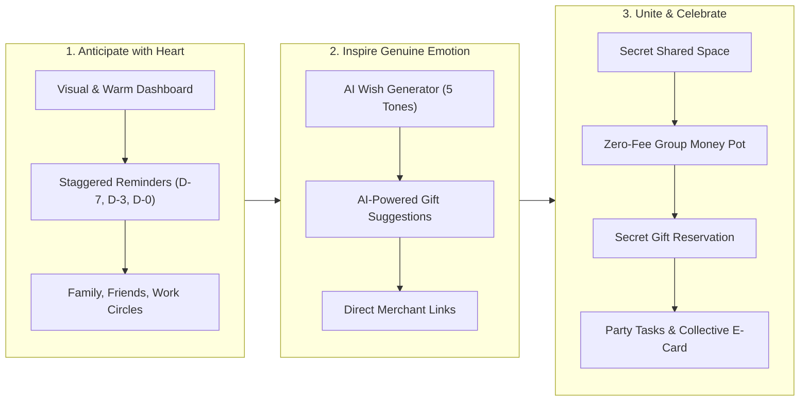

# 📖 The Time2Wish Story: The Art of Celebrating Those Who Matter

---

## 🌟 1. The Genesis: The Modern Paradox of Hyperconnectivity

We live in an era where we have never been more "connected," yet rarely more distant.

Every single day, our smartphones buzz with hundreds of corporate notifications, urgent emails, and algorithmic alerts. But amidst this relentless cognitive overload, a quiet tragedy plays out millions of times: **we forget the birthday of someone we deeply care about**.

Or even worse: we remember it at 11:52 PM, struck by a sudden wave of panic and guilt. We hastily type out a cold, generic three-letter text on WhatsApp: *"HBD 🎂"*.

```
   "52% of adults admit to having forgotten a close friend's or family member's birthday in the past year. 
    67% report feeling sincere guilt, and 34% say it actively strained their relationship."
                                                       — YouGov Survey, Social Relationships & Milestones
```

This missed moment is never due to a lack of love. It is the symptom of a world where emotional memory is buried under daily to-do lists, and where existing digital tools treat our mother’s or best friend’s special day with the exact same coldness as a dentist appointment.

**Time2Wish was created to heal this fundamental human bond.**

---

## 💔 2. The 5 Universal Pains Solved by Time2Wish

Time2Wish was forged from real user experiences, directly addressing the five major hurdles people face when trying to celebrate their loved ones:

### 1. Forgetfulness & Silent Guilt
Traditional calendar apps (Google Calendar, Apple Calendar, Outlook) are built for productivity, not warmth. Squeezed between two business meetings, a loved one's birthday appears as an uninspired plain text line. There is no joy, no anticipation, and no emotional intelligence. When the alert pops up the morning of the event, it is already too late to prepare anything thoughtful.

### 2. The Dreaded "Blank Page" Syndrome
Even when we remember in advance, finding the right words is a persistent struggle. How do you congratulate a mentor with warmth without sounding overly formal? What meaningful, poetic words can you send your sister without sounding cliché? How do you make your childhood friend laugh without being awkward? The result: we hesitate, procrastinate, and end up sending nothing at all.

### 3. The Gift Dilemma & The Fear of Duplicates
Giving a gift should be pure delight; instead, it has turned into an anxiety trigger. What do they actually want? What do they already own? What if someone else buys the exact same item? Walking into a birthday dinner only to find that two friends bought identical books or perfume bottles is an embarrassing situation everyone dreads.

### 4. Chaotic Group Chats & Fee-Heavy Money Pots
Organizing a joint group gift is often an administrative nightmare:
* Creating a secret WhatsApp group while praying you don't accidentally add the birthday person.
* Launching a money pot on external websites (like Leetchi or GoFundMe) that deduct steep fees (up to 4–6% commission) and force every single guest through a tedious account registration process.
* Awkwardly chasing people for money over weeks without knowing exactly how much is left to reach the goal.

### 5. Fragmented Party Planning Left to a Single Person
Organizing a birthday party often burdens a single exhausted host: who is bringing ice? Who handles the cake? Who brings speakers? Without a centralized, friction-free shared task board, essential items get lost in noisy chat threads.

---

## 🚀 3. The Time2Wish Vision: Warm Tech

The mission of Time2Wish is captured in one inspiring promise:
> **"To become the world's most thoughtful celebration companion, transforming stressful social obligations into warm, effortless, and unforgettable moments of joy."**

Time2Wish does not simply ping you with an alarm. It accompanies you through every step of the emotional celebration journey through a unique blend of **Warm Tech**, personalized Generative AI, and seamless group collaboration.



---

## 👥 4. Three Life Stories: Time2Wish Personas

To experience the magic of Time2Wish, let's explore three authentic journeys from real-world personas.

---

### 👩 Story 1: Sophie, 32 — The Caring Mother & Social Hub

> *"I love my people deeply, but between my kids, in-laws, university friends, and team members, I have over 80 birthdays to track. I used to live in constant fear of missing someone special."*

* **Before Time2Wish:** Sophie scribbled dates on kitchen notepads and sticky notes on her fridge. Every year, she ended up forgetting her brother-in-law's birthday or frantically buying an overpriced gas station box of chocolates on her way home from work.
* **With Time2Wish:**
  * On her home screen, loved ones are organized into meaningful social circles (**Family**, **Friends**, **Colleagues**).
  * 7 days before her 10-year-old nephew's birthday (who is obsessed with dinosaurs), Sophie receives a timely email reminder featuring his smiling photo.
  * With one click on her dashboard, she views his saved interests. The Time2Wish AI assistant recommends an authentic paleontology excavation kit with a direct purchasing link.
  * **The Outcome:** Zero stress, a gift delivered three days ahead of time, and the priceless joy of being the thoughtful aunt her nephew adores.

---

### 👨 Story 2: Thomas, 38 — The Busy Professional with a Warm Heart

> *"I freeze whenever I have to write a greeting card. I stare at the blank card for 20 minutes and end up writing the exact same boring sentence every single year."*

* **Before Time2Wish:** For his father's 60th birthday, Thomas wanted to express genuine gratitude for everything his dad had taught him. But the fear of sounding awkward paralyzed him.
* **With Time2Wish:**
  * On the morning of the birthday, a clean notification alerts him.
  * Thomas opens the **AI Wish Generator**, chooses the *Poetic & Emotional* tone, and notes that his father loves woodworking and gardening.
  * In three seconds, the AI crafts three deeply moving paragraphs that use the metaphor of deep roots and standing tall like an oak. Thomas customizes one sentence, moved to tears.
  * **The Outcome:** His father calls him at lunch, deeply touched: *"Son, this is the most beautiful thing anyone has ever written to me."*

---

### 🎉 Story 3: Lucas, Lea & The Crew — The Secret 30th Birthday Conspiracy for Max

> *"Organizing a 30th surprise party with 15 people is usually a disaster: endless debates over gift prices, duplicate gifts, and external money pot sites pocketing 5% in fees."*

* **Before Time2Wish:** A messy WhatsApp group where half the people never respond, delayed bank transfers, and Max finding out about the party because someone accidentally messaged the wrong group chat.
* **With Time2Wish:**
  * Lucas generates a **Secret Shared Link** for Max directly from Time2Wish.
  * **Zero mandatory signup:** His 14 friends simply tap the link on mobile and instantly access the secret planning hub.
  * **Integrated Zero-Fee Group Pot ("Cagnotte"):** Max has been dreaming of a $600 mirrorless camera. Lucas sets up a dedicated pool with a strict $600 cap. Friends pledge their share in real time. The dynamic progress bar animates live and locks once the target is reached. **Zero commission, zero transaction deductions!**
  * **Zero Duplicate Gifts:** Lea secretly claims a handcrafted leather camera strap; the item immediately displays as *"Reserved by Lea"* to everyone else.
  * **Party Tasks:** Lucas lists party essentials (drinks, ice, lemon cake, playlist). Guests self-assign tasks with one tap.
  * **Collective Digital E-Card & Guestbook:** Everyone signs the interactive virtual card with heartfelt messages and funny childhood photos.
  * **The Outcome:** A flawless surprise. On party day, Max scans a QR code on a sealed virtual envelope and discovers heartwarming messages, childhood photos, and his dream camera 100% funded.

---

## 💖 5. Core Pillars of the Time2Wish Philosophy

| Pillar | Our Commitment | Why It Matters |
| :--- | :--- | :--- |
| **Warm Tech** | Harmonious color palettes, smooth animations, interactive confetti, and festive sound effects. | Technology should spark warmth and joy, not look like a sterile corporate spreadsheet. |
| **Privacy First & Zero Ads** | No data brokering, no invasive ad tracking, strictly GDPR compliant. | The birthdays and photos of your children, partner, and friends are private and sacred. |
| **Radical Inclusivity** | Guests can contribute to a gift pot or sign a card without creating an account. | Any digital friction kills spontaneous collective generosity. |
| **All-in-One Emotional Hub** | Reminders + AI Wishes + Gift Ideas + Group Pots + Party Tasks unified in one place. | Eliminates the hassle of juggling Google Calendar, WhatsApp, Leetchi, Amazon, and Canva. |

---

## 🔮 6. Conclusion: Reclaiming Time for What Truly Counts

Time2Wish is not just another software utility. **Time2Wish delivers peace of mind and the quiet pride of always being there for the people you cherish.**

Because at the end of our lives, we won't remember the work emails sent on time, but the warmth in our loved ones' eyes when they realized we remembered them, sincerely and with love.

> **Time2Wish: Never miss a moment to show someone they matter.**
