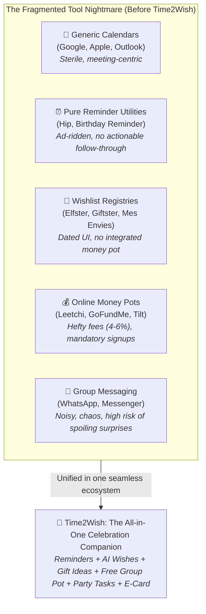

# 📊 Market Comparison & Strategic Positioning

---

## 🔎 1. Overview: The Current Fragmentation of Celebration Tools

The modern birthday and gift planning market is trapped in **five disjointed silos**, forcing users to jump between multiple unrelated applications just to organize a single celebration:



---

## ⚔️ 2. Comprehensive Competitive Matrix (15 Key Criteria)

The table below provides an objective evaluation of Time2Wish against leading international and regional alternatives:

| Evaluation Criteria | Time2Wish (v1.8.0) | Google / Apple Calendar | Hip / Birthday Countdown | Elfster / Giftster | Leetchi / Group Pots | WhatsApp / Messenger |
| :--- | :---: | :---: | :---: | :---: | :---: | :---: |
| **1. 100% Birthday-Centric Warm UX** | **✓✓✓ Yes (Purpose-built)**| ✗ No (Corporate agenda) | ✓✓ Partial | ✗ No (Generic registries) | ✗ No (Pure payment) | ✗ No (General chat) |
| **2. Multi-Stage Reminders (D-14, D-7, D-3, D-0) + Photo** | **✓✓✓ Yes (Automated)** | ✓ Basic (Single alert) | ✓✓ Push notification | ✗ No | ✗ No | ✗ None |
| **3. Relationship Circles (Family / Friends / Work)** | **✓✓✓ Yes (Native)** | ✗ No | ✓ Basic | ✗ No | ✗ No | ✗ Cluttered |
| **4. AI Wish Generator (5 Distinct Emotional Tones)** | **✓✓✓ Yes (Built-in)** | ✗ None | ✗ None | ✗ None | ✗ None | ✗ None |
| **5. AI Personalized Gift Suggestions (by passions)** | **✓✓✓ Yes (Generative)** | ✗ None | ✗ None | ✗ No (Manual entry) | ✗ None | ✗ Subjective |
| **6. Direct Verified Shopping Links (Amazon, etc.)** | **✓✓✓ Yes (1-Click)** | ✗ None | ✗ None | ✓ Raw URLs | ✗ None | ✗ Buried in chat |
| **7. Secret Gift Claiming / Anti-Duplicate Tracking** | **✓✓✓ Yes (Real-Time)** | ✗ None | ✗ None | ✓✓ Yes | ✗ None | ✗ Frequent conflicts |
| **8. Group Funding Pool ("Cagnotte") Linked to Gift** | **✓✓✓ Yes (Integrated)** | ✗ None | ✗ None | ✗ None | ✓✓ Yes (Detached) | ✗ Manual transfers |
| **9. Platform Commission on Money Pots / Pledges** | **0% (Zero Fee)** | N/A | N/A | N/A | **3% to 6% Fee** | 0% |
| **10. Strict Target Limit Cap (Prevents Over-Pledging)**| **✓✓✓ Yes (Automated)** | N/A | N/A | N/A | ✗ No (Can exceed) | ✗ Manual math |
| **11. Mandatory Registration for Guests** | **✗ No (Frictionless)** | ✓ Account needed | ✓ Account needed | ✓ Account needed | ✓ Mandatory signup | ✓ Account needed |
| **12. Party Planner & Self-Assigned Tasks (Food, etc.)**| **✓✓✓ Yes (Interactive)**| ✗ None | ✗ None | ✗ None | ✗ None | ✗ Lost in scroll |
| **13. Collective Virtual E-Card & Digital Guestbook** | **✓✓✓ Yes (Signatures)**| ✗ None | ✗ None | ✗ None | ✗ None | ✗ Dispersed media |
| **14. Strict Data Privacy & Zero Advertising** | **✓✓✓ Strict (GDPR)** | ✓✓ Ad-profiling | ✗ Heavy ad popups | ✓ Third-party trackers | ✓ Cross-sell ads | ✓ Meta ad tracking |
| **15. Multiplatform Parity (Web PWA, iOS, Android, Flutter)** | **✓✓✓ Full Parity** | ✓✓ Native apps | ✗ Mobile only | ✗ Dated web | ✗ Basic web/mobile | ✓ Cross-platform |
| **OVERALL SUITABILITY SCORE (/100)** | **95 / 100** | **45 / 100** | **52 / 100** | **58 / 100** | **50 / 100** | **38 / 100** |

---

## 🔬 3. In-Depth Competitor Category Analysis

### 1. Generic Calendars (Google Calendar, Apple Calendar, Outlook)
* **Strengths:** Universally installed, seamless calendar sync.
* **Fatal Flaws:**
  * **Sterile Corporate Feel:** Your partner's birthday looks identical to a quarterly tax deadline.
  * **Zero Celebration Intelligence:** No gift assistance, no wish inspiration, no secret party coordination.
  * **Rigid Single Reminders:** Usually pops up on the day of the birthday at 9:00 AM, when it is already too late to arrange a thoughtful gift.

### 2. Pure Birthday Reminder Apps (Hip, Birthday Reminder & Countdown)
* **Strengths:** Dedicated to date tracking, clean day countdowns.
* **Fatal Flaws:**
  * **Aggressive Ad Monetization:** Full-screen video ads and intrusive banners ruin what should be a joyful experience.
  * **No Actionable Follow-Through:** Alerts you about the date, but leaves you stranded with a blank page, no gift ideas, and no collaboration tools.
  * **Isolated Utility:** Cannot invite friends to organize a joint surprise.

### 3. Wishlist Registries (Elfster, Giftster, Mes Envies)
* **Strengths:** Helps avoid unwanted gifts through wishlist check-offs.
* **Fatal Flaws:**
  * **Dated User Experience:** Built on legacy 2010s architectures, lacking modern glassmorphism aesthetics and fluid mobile ergonomics.
  * **Detached from Social Circles:** Static registries designed for Christmas secret santas or weddings, disconnected from year-round birthday timelines.
  * **No Native Money Pot:** When a gift costs $300, friends have to leave the app and organize bank transfers elsewhere.

### 4. Crowdfunding & Money Pot Platforms (Leetchi, GoFundMe, Tilt/Lydia)
* **Strengths:** Solid payment gateway infrastructure.
* **Fatal Flaws:**
  * **Exorbitant Fees:** Pocketing 3% to 6% of the money you pooled for a loved one's gift is widely perceived as unfair by contributors.
  * **Massive Signup Friction:** Every participant must create an account, verify their identity, and enter bank cards, causing up to 30% drop-off.
  * **Decontextualized Experience:** Just a blank payment page; fails to solve gift curation, party logistics, or emotional greetings.

### 5. Group Messaging Apps (WhatsApp, Messenger, Telegram)
* **Strengths:** High ubiquity and instant adoption.
* **Fatal Flaws:**
  * **The Fatal Spoiler Risk:** Accidentally adding the birthday celebrant to the surprise group or posting in the wrong chat instantly ruins the surprise.
  * **Information Black Hole:** Gift ideas, addresses, and budget promises get buried under 400 memes and unrelated messages.
  * **No Central Overview:** Impossible to see at a glance who is bringing what or how much money is left to fund the gift.

---

## 🌊 4. The Time2Wish "Blue Ocean" Strategy

Time2Wish does not seek to fight a bloody battle against Google Calendar for office productivity or WhatsApp for general messaging. **Time2Wish created an uncontested market space: The Emotion-Driven, Collaborative Celebration Ecosystem.**

```
          RED COMPETITIVE SPACE                                    TIME2WISH BLUE OCEAN
  ┌────────────────────────────────────────┐                ┌───────────────────────────────────┐
  │ • Cold, cluttered agendas              │                │ • 100% Celebration Experience     │
  │ • Invasive ads & data tracking         │   ───────►     │ • Warm Generative AI Assistant    │
  │ • 4% to 6% money pot fees              │                │ • Zero-Fee Integrated Group Pots  │
  │ • Juggling 5 disconnected apps         │                │ • Leak-Free Secret Collaboration  │
  │ • Generic, hollow greeting texts       │                │ • Absolute Privacy & Respect      │
  └────────────────────────────────────────┘                └───────────────────────────────────┘
```

### The Four Actions Framework (Eliminate / Reduce / Raise / Create)

1. **ELIMINATE:**
   * Invasive banner advertisements and user data profiling.
   * High percentage fees on birthday money pools among friends.
   * Forced account creation for guests viewing a secret birthday link.
2. **REDUCE:**
   * Time spent hunting for the right gift (from 3 hours down to 30 seconds via AI).
   * Cognitive overload and stress placed on the main party organizer.
   * The embarrassing risk of buying duplicate gifts.
3. **RAISE:**
   * Meaningful anticipation through smart staggered alerts (D-14, D-7, D-3, D-0).
   * Visual delight through a premium Glassmorphism design and tactile haptics.
   * Group participation via interactive gift voting and self-assigned tasks.
4. **CREATE:**
   * The first multi-tone emotional AI greeting generator.
   * Directly embedded gift funding pools with strict target caps.
   * The sealed virtual celebration envelope with collective guestbook signatures and childhood photos.

---

## 🏆 5. Unique Value Proposition (UVP)

> **For** thoughtful individuals who cherish their relationships,  
> **Who** feel overwhelmed by busy schedules and the stress of organizing celebrations,  
> **Time2Wish is** the all-in-one personal celebration ecosystem,  
> **That** anticipates key dates, crafts tailored AI wishes and gift ideas, and unites loved ones through zero-fee group pots and secret planning,  
> **Unlike** sterile corporate calendars or fee-heavy money pot sites,  
> **Our platform** turns every birthday into a warm, unforgettable, and effortless connection.
