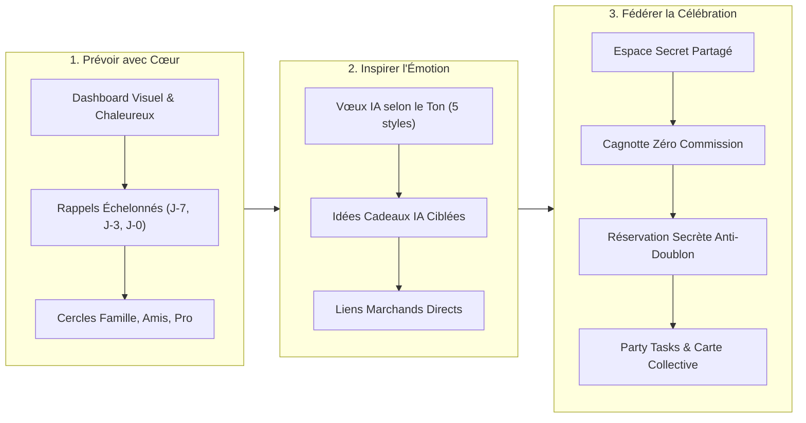

# 📖 Le Storytelling de Time2Wish : L'Art de Célébrer Ceux Qui Comptent

---

## 🌟 1. La Genèse : Le Paradoxe de l'Hyperconnexion Moderne

Nous vivons dans une époque où nous n'avons jamais été aussi « connectés », et pourtant rarement aussi distants. 

Chaque jour, nos smartphones vibrent au rythme de centaines de notifications professionnelles, de courriels urgents et d'alertes algorithmiques. Mais au milieu de cette surcharge cognitive permanente, une tragédie discrète se répète des millions de fois : **nous oublions l'anniversaire d'une personne que nous aimons profondément**.

Ou pire encore : nous nous en souvenons à 23h52, saisis d'un éclair de panique et d'une culpabilité dévorante. Nous nous contentons alors d'envoyer un message froid de trois lettres tapé à la hâte sur WhatsApp : *"HBD 🎂"*. 

```
   « 52% des adultes admettent avoir oublié l'anniversaire d'un proche au cours des douze derniers mois. 
      67% en éprouvent une culpabilité sincère, et 34% constatent que cela a altéré le lien affectif. »
                                                            — Étude YouGov, Social Relationships & Milestones
```

Ce geste manqué n'est pas le reflet d'un manque d'amour. Il est le symptôme d'un monde où la mémoire affective est ensevelie sous les to-do lists, et où les outils numériques actuels traitent la fête de notre mère ou de notre meilleur ami de la même manière qu'un rendez-vous chez le dentiste.

**C'est pour réparer ce lien humain fondamental qu'est né Time2Wish.**

---

## 💔 2. Les 5 Douleurs Universelles Résolues par Time2Wish

Time2Wish a été forgé autour du vécu authentique de centaines d'utilisateurs confrontés à cinq obstacles récurrents :

### 1. L'Oubli et la Culpabilité Silencieuse
Les calendriers classiques (Google Calendar, Outlook) sont des outils de productivité froide. Noyé entre deux réunions professionnelles, un anniversaire apparaît comme une simple ligne textuelle. Aucune émotion, aucune anticipation. Quand l'alarme sonne le matin même, il est souvent trop tard pour organiser quoi que ce soit d'attentionné.

### 2. Le Syndrome de la « Page Blanche »
Même lorsqu'on se souvient de la date, trouver les mots justes est un calvaire récurrent. Comment féliciter un collègue avec élégance sans paraître guindé ? Quel message émouvant et sincère envoyer à sa sœur sans tomber dans les banalités éculées ? Comment faire rire son meilleur ami sans être lourd ? Résultat : on reporte, et on finit par ne rien envoyer.

### 3. Le Casse-Tête du Cadeau et la Peur du Doublon
Offrir un cadeau devrait être un plaisir pur ; c'est devenu une source d'anxiété. Que lui offrir ? Que possède-t-il déjà ? Qui d'autre a eu la même idée ? Le cauchemar d'arriver à une fête et de découvrir que deux personnes ont acheté exactement le même livre ou le même parfum est une réalité embarrassante que tout le monde redoute.

### 4. Le Chaos des Groupes WhatsApp et des Cagnottes Éparpillées
Pour organiser un cadeau commun, le calvaire commence :
* Créer un groupe WhatsApp secret en priant pour ne pas y inviter par erreur la personne dont c'est l'anniversaire.
* Ouvrir une cagnotte sur un site tiers (Leetchi, Pot Commun) qui réclame des frais exorbitants (jusqu'à 6% de commission) et impose la création de comptes fastidieux à chaque participant.
* Relancer dix fois les retardataires sans savoir précisément combien il manque.

### 5. La Fête Désorganisée où Tout Repose sur une Seule Personne
L'organisateur d'un anniversaire porte souvent un fardeau démesuré : qui apporte les boissons ? Qui gère le gâteau ? Qui prend les glaçons ? Faute d'un tableau de bord partagé simple et anonyme, les tâches se perdent dans des fils de discussion interminables.

---

## 🚀 3. La Vision Time2Wish : L'Écosystème Bienveillant ("Warm Tech")

La mission de Time2Wish se résume en une promesse lumineuse :
> **« Devenir le compagnon d'anniversaire le plus prévenant au monde, pour transformer une obligation mentale stressante en un moment de célébration chaleureux, complice et inoubliable. »**

Time2Wish ne se contente pas de vous notifier : il vous accompagne à chaque étape du parcours affectif grâce à une alliance unique entre technologie chaleureuse (*Warm Tech*), intelligence artificielle personnalisée et collaboration collective instantanée.



---

## 👥 4. Trois Histoires de Vie : Les Personas Time2Wish

Pour comprendre la magie de Time2Wish, plongeons dans le quotidien de ceux pour qui l'application a tout changé.

---

### 👩 Story 1 : Sophie, 32 ans — La Maman Active & Cheffe de Famille

> *« J'adore mes proches, mais j'ai 85 anniversaires à retenir entre mes enfants, ma belle-famille, mes amis d'enfance et mes collègues. Avant, je vivais dans la peur constante d'en rater un. »*

* **Avant Time2Wish :** Sophie notait tout sur un calepin et des post-its qui traînaient sur le frigo. Chaque année, elle oubliait l'anniversaire de son beau-frère ou achetait un cadeau en catastrophe dans une station-service à 19h30.
* **Avec Time2Wish :** 
  * Dès l'accueil, les avatars de ses proches sont classés par cercles de vie (**Famille**, **Amis**, **Travail**). 
  * À J-7 de l'anniversaire de son neveu de 10 ans passionné de dinosaures, Sophie reçoit un rappel par courriel avec la photo de son neveu.
  * En un clic sur son dashboard, elle consulte les centres d'intérêt renseignés. L'IA de Time2Wish lui suggère un kit de fouille paléontologique avec lien d'achat immédiat.
  * **Le résultat :** Zéro stress, un cadeau parfait livré trois jours à l'avance, et le sentiment précieux d'être une tante formidable.

---

### 👨 Story 2 : Thomas, 38 ans — Le Cadre Pressé au Cœur Tendre

> *« Je suis nul pour écrire des cartes. Devant une page blanche, je bloque pendant 20 minutes et je finis par écrire la même formule bateau que tout le monde. »*

* **Avant Time2Wish :** Pour les 60 ans de son père, Thomas voulait exprimer sa gratitude pour tout ce qu'il lui a transmis, mais les mots ne venaient pas. La peur du ridicule le paralysait.
* **Avec Time2Wish :** 
  * Le matin même, une notification élégante l'alerte. 
  * Thomas ouvre le **Générateur de Vœux IA**. Il sélectionne le ton *« Poétique & Émotionnel »*, indique que son père est passionné de menuiserie et de jardinage.
  * En 3 secondes, l'IA génère trois propositions magnifiques, filant la métaphore des arbres solides qu'on plante et des racines familiales. Thomas personnalise une phrase, les larmes aux yeux.
  * **Le résultat :** Son père l'appelle à midi, bouleversé par ce message : *"C'est le plus beau texte que tu m'aies jamais écrit mon fils."*

---

### 🎉 Story 3 : Lucas, Léa et leur Bande — Le Complot Surprise pour les 30 ans de Maxime

> *« Organiser les 30 ans d'un pote à 15 personnes, c'est d'habitude l'enfer sur terre : disputes sur le prix, 4 personnes qui achètent la même chose, et des cagnottes qui prennent 5% de commission. »*

* **Avant Time2Wish :** Un groupe WhatsApp secret où 3 personnes ne répondent jamais, un virement bancaire oublié par la moitié du groupe, et Maxime qui découvre la surprise parce qu'un ami s'est trompé de conversation.
* **Avec Time2Wish :**
  * Lucas génère un **Lien de Partage Secret** pour Maxime depuis Time2Wish.
  * **Zéro inscription obligatoire :** Ses 14 amis cliquent sur le lien depuis leur mobile et accèdent à l'espace secret.
  * **Cagnotte collaborative intégrée :** Maxime rêve d'un appareil photo hybride à 600 €. Lucas ouvre une cagnotte dédiée avec un objectif strict de 600 €. Chacun verse sa promesse en direct. La jauge progresse en temps réel avec animation confetti dès que le plafond est atteint. Zéro centime de frais bancaires ou de plateforme intermédiaire !
  * **Anti-doublon absolu :** Léa réserve en secret une sangle en cuir artisanale ; le cadeau apparaît instantanément comme *« Réservé par Léa »* pour les autres.
  * **Party Tasks :** Lucas crée la liste des besoins (packs d'eau, sono, gâteau citron). Chacun s'auto-attribue une tâche d'un tap.
  * **Livre d'or digital & E-Card :** Tous signent la carte virtuelle interactive avec des petits mots et des photos d'enfance.
  * **Le résultat :** Une surprise totale le jour J. Maxime scanne un QR code sur son enveloppe virtuelle et découvre les messages, les photos et le cadeau rêvé financé à 100%.

---

## 💖 5. Les Piliers Fondamentaux de la Philosophie Time2Wish

| Pilier | Notre Engagement | Pourquoi c'est Vital |
| :--- | :--- | :--- |
| **Warm Tech (Technologie Chaleureuse)** | Interface aux dégradés soignés, animations douces, confettis interactifs et sons de fête. | La technologie doit susciter le sourire et l'émotion, pas l'austérité d'une feuille Excel. |
| **Privacy First & Zéro Publicité** | Aucune revente de données personnelles, aucun tracking publicitaire invasif. | Les dates de naissance et les photos de vos enfants et proches sont sacrées et privées. |
| **Inclusivité & Simplicité Radicale** | Vos amis peuvent participer à une cagnotte ou signer une carte sans avoir à créer de compte. | Le moindre frottement technique détruit l'élan spontané de générosité d'un groupe. |
| **All-in-One Émotionnel** | Rappel + Vœux IA + Idées Cadeaux + Cagnotte + Party Tasks réunis en un seul lieu. | Évite de jongler entre Google Calendar, WhatsApp, Leetchi, Amazon et Canva. |

---

## 🔮 6. Conclusion : Redonner du Temps à Ce Qui Compte Vraiment

Time2Wish ne vend pas des fonctionnalités logicielles. **Time2Wish offre la sérénité d'esprit et la fierté d'être présent pour ceux qui comptent.**

Parce qu'au crépuscule de notre existence, nous ne nous souviendrons pas des réunions professionnelles honorées à l'heure, mais des regards émerveillés de nos proches lorsqu'ils ont compris que nous avions pensé à eux, avec cœur et sincérité.

> **Time2Wish : Ne manquez plus jamais une occasion de dire à quelqu'un qu'il est précieux.**
