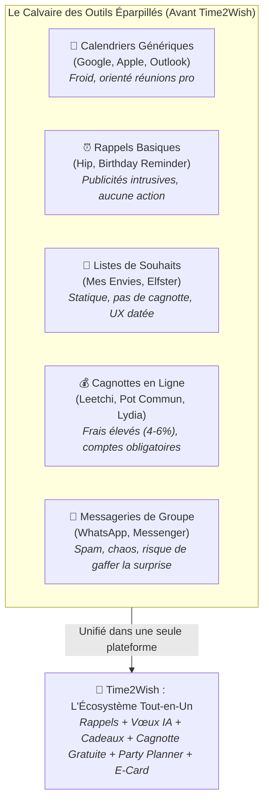

# 📊 Étude Comparative du Marché & Positionnement Stratégique

---

## 🔎 1. Vue d'Ensemble : L'Écosystème Actuel et ses Limites

Le marché de la gestion des anniversaires et des cadeaux est aujourd'hui fragmenté en **cinq silos isolés**, obligeant les utilisateurs à jongler entre plusieurs applications disparates pour organiser un seul anniversaire :



---

## ⚔️ 2. Matrice Comparative Exhaustive (15 Critères Clés)

La matrice ci-dessous évalue objectivement Time2Wish face aux principales alternatives du marché international et francophone :

| Critères d'Évaluation | Time2Wish (v1.8.0) | Google / Apple Calendar | Hip / Birthday Reminder | Mes Envies / Elfster | Leetchi / Pot Commun | WhatsApp / Groupes |
| :--- | :---: | :---: | :---: | :---: | :---: | :---: |
| **1. Expérience 100% Dédiée aux Anniversaires** | **✓✓✓ Oui (Warm UX)** | ✗ Non (Agenda pro) | ✓✓ Partielle | ✗ Non (Listes Noël/Mariage) | ✗ Non (Paiement pur) | ✗ Non (Chat général) |
| **2. Rappels Échelonnés (J-14, J-7, J-3, J-0) avec Photo** | **✓✓✓ Oui (Automatisé)** | ✓ Basique (1 alerte) | ✓✓ Push mobile | ✗ Non | ✗ Non | ✗ Aucun |
| **3. Organisation par Cercles (Famille / Amis / Pro)** | **✓✓✓ Oui (Natif)** | ✗ Non | ✓ Limité | ✗ Non | ✗ Non | ✗ Flou |
| **4. Rédacteur de Vœux IA (5 Tonalités d'émotion)** | **✓✓✓ Oui (Intégré)** | ✗ Aucun | ✗ Aucun | ✗ Aucun | ✗ Aucun | ✗ Aucun |
| **5. Idées Cadeaux Intelligentes par IA (selon passions)** | **✓✓✓ Oui (Génératif)** | ✗ Aucun | ✗ Aucun | ✗ Non (Saisie manuelle) | ✗ Aucun | ✗ Subjectif |
| **6. Liens d'Achat Directs (Amazon, Fnac, Etsy)** | **✓✓✓ Oui (1-clic)** | ✗ Non | ✗ Non | ✓ Liens bruts | ✗ Non | ✗ Liens perdus |
| **7. Réservation Secrète de Cadeaux (Anti-Doublons)** | **✓✓✓ Oui (Temps réel)** | ✗ Non | ✗ Non | ✓✓ Oui | ✗ Non | ✗ Conflits fréquents |
| **8. Cagnotte Collaborative Intégrée au Cadeau** | **✓✓✓ Oui (Liée au don)**| ✗ Non | ✗ Non | ✗ Non | ✓✓ Oui (Isolée) | ✗ Virement manuel |
| **9. Commission sur Cagnotte / Promesse de Don** | **0% (Sans Frais)** | N/A | N/A | N/A | **3% à 6% de frais** | 0% |
| **10. Plafond Strict Anti-Dépassement de Cagnotte** | **✓✓✓ Oui (Automatique)**| N/A | N/A | N/A | ✗ Non (Dépassable) | ✗ Flou |
| **11. Inscription Obligatoire pour les Invités** | **✗ Non (Accès direct)** | ✓ Compte requis | ✓ Compte requis | ✓ Compte requis | ✓ Compte obligatoire | ✓ Compte requis |
| **12. Party Planner & Tâches Partagées (Boissons, etc.)** | **✓✓✓ Oui (Attribution)**| ✗ Non | ✗ Non | ✗ Non | ✗ Non | ✗ Listes noyées |
| **13. E-Card Collective & Livre d'Or Digital** | **✓✓✓ Oui (Signatures)**| ✗ Non | ✗ Non | ✗ Non | ✗ Non | ✗ Médias dispersés |
| **14. Respect de la Vie Privée & Zéro Publicité** | **✓✓✓ Strict (RGPD)** | ✓✓ Profilage publicitaire | ✗ Bannières partout | ✓ Traqueurs pub | ✓ Publicités / Up-sell | ✓ Métadonnées Meta |
| **15. Multiplateforme (Web PWA, iOS, Android, Flutter)** | **✓✓✓ Parité Totale** | ✓✓ Natif | ✗ Mobile seul | ✗ Web ancien | ✗ Web / Mobile basique | ✓ Multiplateforme |
| **SCORE GLOBAL D'ADÉQUATION (/100)** | **95 / 100** | **45 / 100** | **52 / 100** | **58 / 100** | **50 / 100** | **38 / 100** |

---

## 🔬 3. Analyse Détaillée par Famille de Concurrents

### 1. Les Calendriers Universels (Google Calendar, Apple Calendar, Outlook)
* **Forces :** Déjà installés sur la quasi-totalité des appareils, synchronisation native des agendas.
* **Faiblesses Critiques :**
  * **Atmosphère bureaucratique :** L'anniversaire de votre mère apparaît entre *"Point RH trimestriel"* et *"Rendez-vous dentiste"*.
  * **Zéro intelligence relationnelle :** Aucun conseil de cadeau, aucun générateur de vœux, aucune organisation de surprise.
  * **Rappels rigides :** Souvent une simple alerte le jour J à 09h00 du matin, quand il est déjà trop tard pour faire livrer un cadeau.

### 2. Les Applications de Rappel d'Anniversaires (Hip, Birthday Reminder & Countdown)
* **Forces :** Centrées sur la date, affichent le décompte des jours restants.
* **Faiblesses Critiques :**
  * **Modèle publicitaire agressif :** Des bannières et pop-ups vidéo intrusifs qui dégradent l'expérience utilisateur.
  * **Absence d'action après l'alerte :** L'application vous rappelle que c'est l'anniversaire, mais ne vous aide ni à rédiger le mot, ni à acheter un cadeau, ni à organiser un événement.
  * **Ermitage individuel :** Impossible d'inviter des proches pour mutualiser un achat ou des préparatifs.

### 3. Les Registres & Listes de Souhaits (Mes Envies, Elfster, Giftster)
* **Forces :** Évitent d'offrir des cadeaux inutiles grâce au système de coche ou réservation.
* **Faiblesses Critiques :**
  * **Expérience utilisateur datée :** Interfaces héritées des années 2010, manquant cruellement de modernité, de fluidité et d'esthétique glassmorphism.
  * **Déconnectées du calendrier :** Ce sont des listes statiques créées pour Noël ou les mariages, sans suivi chronologique dynamique des cercles d'amis.
  * **Pas de cagnotte native :** Si un cadeau coûte 300 €, la plateforme ne permet pas de se cotiser facilement ; il faut renvoyer vers un RIB ou un service externe.

### 4. Les Plateformes de Cagnottes (Leetchi, Le Pot Commun, Lydia Cagnotte)
* **Forces :** Collecte d'argent efficace, système bancaire sécurisé.
* **Faiblesses Critiques :**
  * **Frais prohibitifs :** Prélèvement de 3% à 6% sur l'argent offert à vos amis, souvent perçu comme injuste par les donateurs.
  * **Friction monumentale :** Chaque ami doit créer un compte, valider son identité ou enregistrer sa carte bancaire, décourageant 30% des participants potentiels.
  * **Absence totale de contexte émotionnel :** Une cagnotte est une page blanche avec un bouton de paiement ; elle ne résout ni l'idée de cadeau, ni les tâches de la fête, ni les messages de vœux.

### 5. Les Groupes de Messagerie (WhatsApp, Messenger, Telegram)
* **Forces :** Tout le monde les a déjà installés.
* **Faiblesses Critiques :**
  * **Le risque mortel de la gaffe :** Inviter par mégarde le principal intéressé ou poster un message dans le mauvais groupe familial détruit immédiatement l'effet de surprise.
  * **Le trou noir informationnel :** Les idées cadeaux, les adresses et les promesses financières sont noyées sous 400 messages de blagues et de gifs animés.
  * **Zéro synthèse :** Aucun moyen de savoir en un coup d'œil qui apporte quoi ou combien d'argent a été réuni pour le cadeau.

---

## 🌊 4. La Stratégie « Océan Bleu » de Time2Wish

Time2Wish ne cherche pas à concurrencer frontalement Google Calendar sur la productivité ou WhatsApp sur la messagerie instantanée générale. **Time2Wish a créé son propre espace de marché vierge : l'Écosystème Émotionnel et Collaboratif d'Anniversaire.**

```
          ESPACE CONCURRENTIEL ROUGE                                OCÉAN BLEU TIME2WISH
  ┌────────────────────────────────────────┐                ┌───────────────────────────────────┐
  │ • Calendriers froids et surchargés     │                │ • Expérience 100% Célébration     │
  │ • Publicités intrusives                │   ───────►     │ • IA Générative Bienveillante     │
  │ • Frais de cagnottes de 4 à 6%         │                │ • Cagnotte Zéro Frais Intégrée    │
  │ • Éparpillement sur 5 applications     │                │ • Coordination Secrète Zéro Bug   │
  │ • Répétition des mêmes vœux bateaux    │                │ • Respect Absolu de la Vie Privée │
  └────────────────────────────────────────┘                └───────────────────────────────────┘
```

### La Règle des 4 Actions (Grille d'Élimination / Création)

1. **ÉLIMINER :**
   * Les publicités invasives et le pistage des données personnelles.
   * Les commissions bancaires sur les cagnottes d'anniversaire entre amis.
   * L'obligation d'inscription pour les invités qui consultent un lien secret.
2. **RÉDUIRE :**
   * Le temps passé à chercher un cadeau pertinent (de 3 heures à 30 secondes grâce à l'IA).
   * La charge mentale pesant sur l'organisateur principal de l'événement.
   * Le risque embarrassant d'acheter un cadeau en doublon.
3. **AUGMENTER :**
   * L'anticipation émotionnelle grâce aux alertes séquencées (J-14, J-7, J-3, J-0).
   * La beauté visuelle de l'outil grâce au design Glassmorphism haut de gamme.
   * L'engagement du groupe grâce au vote interactif des cadeaux et aux Party Tasks.
4. **CRÉER :**
   * Le premier générateur de vœux émotionnels multi-tons dopé par IA.
   * La promesse de don directement attachée à la fiche d'un cadeau avec jauge temps réel stricte.
   * L'enveloppe virtuelle scellée avec livre d'or et carte collective à débloquer le jour J.

---

## 🏆 5. Synthèse de la Proposition de Valeur Unique (UVP)

> **Pour** les adultes soucieux de préserver et nourrir leurs liens affectifs,  
> **Qui** sont submergés par le quotidien et stressés par l'organisation des anniversaires,  
> **Time2Wish est** la seule application tout-en-un de célébration personnelle,  
> **Qui** anticipe les dates clés, génère les vœux et cadeaux idéaux par IA, et fédère les proches autour de cagnottes et surprises gratuites,  
> **Contrairement aux** agendas professionnels froids ou aux plateformes de cagnotte payantes,  
> **Notre solution** transforme chaque anniversaire en un souvenir inoubliable, chaleureux et sans friction.
